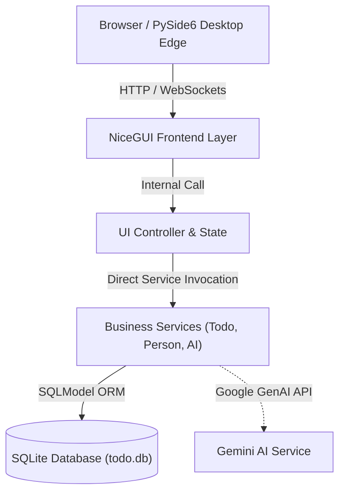

# ToDo App (NiceGUI Standalone)

[](https://github.com/rogga218/ToDo-Standalone/actions/workflows/test.yml)


A modern, fast, and simple ToDo application built with **NiceGUI** and **SQLite**. 
> Developed with **Google Antigravity** and **Gemini**.

This project has been refactored to specifically focus on a single, native Python implementation. It is primarily built to be deployed as a **Container (Podman/Docker)**, with the added bonus of being easily bundled into a unified **Standalone Desktop App (.exe)**.

## Table of Contents
- [System Architecture](#system-architecture)
- [Features](#features)
- [Tech Stack](#tech-stack)
- [Developer & Tester Cheatsheet](#developer--tester-cheatsheet)
- [Project Structure & Directory Guidance](#project-structure--directory-guidance)
- [Getting Started](#getting-started)
- [Running the App](#running-the-app)
- [Testing & Data](#testing--data)
- [License](#license)


## System Architecture



## Features

-   **Container First Deployment**: Optimized for Podman/Docker orchestrations for seamless, isolated hosting.
-   **Bonus: Standalone Desktop App**: Can be packaged as a maximized native OS window (via `PySide6` and background threading) for local desktop setups without requiring a server.
-   **Native Python UI**: Fast and reactive interfaces built with [NiceGUI](https://nicegui.io).
-   **Integrated Architecture**: FastAPI and business logic run directly within the same process—eliminating internal HTTP network overhead.
-   **Zero-Config Database**: Uses a local SQLite database file (`todo.db`) for immediate out-of-the-box usage.
-   **AI Assistant Integration**: Auto-generates intelligent subtasks using Google Gemini (`google-genai`).
-   **Localization**: First-class built-in support for English and Swedish.
-   **Modern UX**: Features persistent dark mode, pagination, responsive layouts, data filtering, and sleek dialogs.
-   **Robust Process Management**: Ensures clean exits with zero zombie processes on shutdown.

## Tech Stack

### Core Application
-   **User Interface**: [NiceGUI](https://nicegui.io) (Vue.js, Tailwind CSS)
-   **Web Framework**: FastAPI & Uvicorn (Integrated)
-   **Database Provider**: SQLite & SQLModel (ORM / Pydantic V2)
-   **AI Engine**: Google Generative AI (Gemini)

### Desktop Integration & Build
-   **Native Window Edge**: `PySide6` (QtWebEngineView)
-   **Process Management**: `psutil`
-   **Executable Bundle**: PyInstaller

### Quality & Testing
-   **Testing Framework**: pytest & pytest-asyncio
-   **Coverage**: pytest-cov (Enforced strict coverage threshold >65%)
-   **Linting & Formatting**: Ruff
-   **Type Checking**: Mypy

## Developer & Tester Cheatsheet

| Task | Command |
| :--- | :--- |
| **Run App Locally** | `python -m src.main` |
| **Run via Podman/Docker** | `podman-compose up --build -d` |
| **Fast Unit Tests** | `pytest -m "not gui"` |
| **E2E Playwright Browser Tests** | `npx playwright test` |
| **Lint & Type Check** | `ruff check src` && `mypy src` |
| **Seed Test Data** | `python -m src.seed_data` |
| **Build Desktop .exe** | `pip install -r requirements-build.txt` && `python build.py` |

## Project Structure & Directory Guidance

```
├── .env.example              # Configuration environment template
├── Dockerfile & docker-compose.yml # Container orchestration
├── requirements.txt          # App & development dependencies
├── requirements-build.txt    # Standalone desktop EXE build dependencies
├── build.py                  # PyInstaller executable build script
│
├── src/                      # Application Source Code
│   ├── main.py               # Main entry point (starts FastAPI + NiceGUI)
│   ├── backend_app.py        # FastAPI app initialization & route mounting
│   ├── models.py             # SQLModel data schemas (Todo, Person, SubTask)
│   ├── database.py           # SQLite connection & session management
│   ├── config.py             # Environment configuration (pydantic-settings)
│   ├── core/                 # Error handling & process lifecycle management
│   ├── services/             # Business logic (todo_service, person_service, ai_service)
│   ├── routers/              # FastAPI REST endpoints (/todos, /persons, /ai)
│   └── ui/                   # NiceGUI Frontend Layer
│       ├── controller.py     # UI Controller & state management
│       ├── theme.py          # Persistent dark/light theme engine
│       ├── translations.py   # Multilingual localization (EN / SV)
│       ├── components/       # Reusable UI dialogs and modals
│       └── pages/            # Page layouts (Board, History views)
│
├── tests/                    # Automated Python Test Suite
│   ├── conftest.py           # Pytest fixtures & test setup
│   └── test_*.py             # Service, Router, Model & Controller unit tests
│
└── e2e/                      # End-to-End Playwright Browser Tests (TypeScript)
    └── todo.spec.ts          # E2E browser user flow tests
```

## Getting Started

### Prerequisites

- **Python 3.14+**
- **Node.js (v18+) & npm** - *Required for Playwright E2E browser tests*
- **Podman or Docker** - *Required for containerized deployment*

### Installation

1. **Clone the repository**:
   ```bash
   git clone https://github.com/rogga218/ToDo-Standalone.git
   cd ToDo-Standalone
   ```

2. **Create a virtual environment**:
   ```bash
   python -m venv .venv
   .venv\Scripts\activate  # Windows
   # source .venv/bin/activate # Linux/Mac
   ```

3. **Install dependencies**:
   ```bash
   pip install -r requirements.txt
   npm install
   ```

### Configuration

Create a `.env` file in the root directory (use `.env.example` as a template).

| Variable | Description | Default |
| :--- | :--- | :--- |
| `DATABASE_URL` | Database connection string | `sqlite:///data/todo.db` |
| `GEMINI_API_KEY` | API Key for AI features | `None` |
| `GEMINI_MODEL` | Gemini Model Alias | `gemini-flash-latest` |
| `STORAGE_SECRET` | Secret for session encryption | `random_secret_for_session_encryption` |
| `PORT` | Local dev port | `8080` |


> **Tip:** To generate a secure `STORAGE_SECRET`, run `python scripts/generate_secret.py` and copy the output.

## Running the App

### Run with Podman/Docker

Build and start the container:
```bash
podman-compose up --build -d
```
```bash
docker-compose up --build -d
```
The app will be available at [http://localhost:8080](http://localhost:8080).

### Building as Executable (.exe)

To package the application as a standalone `.exe` file (Windows):

1.  **Install Build Dependencies**:
    The main project dependencies are intentionally kept lightweight. To build the `.exe`, install the extra PySide6 and PyInstaller compiler wheels.
    ```bash
    pip install -r requirements-build.txt
    ```

2.  **Run the Build Script**:
    ```bash
    python build.py
    ```
    This script will package the app routing a headless FastAPI to an insulated PySide6 application window into the `dist/` folder.

3.  **Run the Executable**:
    Locate `dist/ToDoApp.exe` and run it. The database `todo.db` will be created in the same folder.

### Development Mode

Run the application directly with Python:
```bash
python -m src.main
```
The app will be available at [http://localhost:8080](http://localhost:8080).

## Testing & Data

This section covers how to run automated tests and seed the database with test data.

### Running Tests

The test suite includes:
- **Unit Tests**: Services, Models, API Client (Mocked), UI Controller (Mocked), and Core Utilities.
- **Integration Tests**: FastAPI endpoint edge cases and routing against an in-memory database.
- **Coverage Enforcement**: The test suite mandates strict code coverage testing (`pytest-cov > 65%`).
> *A timestamped test report is generated in `tests/testreport/` after each run.*

To run the automated test suite using `pytest`:

**Run Unit Tests Only (Default for CI):**

*With Podman/Docker:*
```bash
podman-compose run --rm app pytest -m "not gui"
```

*Locally:*
```bash
pytest -m "not gui"
```

**Run Python GUI Tests Only (Legacy):**

```bash
pytest -m gui
```

**Run Node.js E2E Tests (Recommended):**

We use Node-based Playwright for comprehensive end-to-end testing with UI Mode and Trace Viewer. Playwright will automatically start the backend server before testing.

```bash
npx playwright test
```

To debug tests visually:
```bash
npx playwright test --ui
```

**Run All Tests (Unit + GUI):**

*With Podman/Docker (GUI tests will be skipped if no browser is available in the container):*
```bash
podman-compose run --rm app pytest
```

*Locally:*
```bash
pytest
```

### Code Quality & Continuous Integration (CI)

This project adheres to a strict "Zero-Warning Policy" for code formatting and typing.
We use **Ruff** for linting and formatting, **Mypy** for static type checking, **PyPA gh-action-pip-audit** for vulnerability scanning, and **Pytest** for testing.

These checks are automatically executed in GitHub Actions CI on every push and pull request.

To check and format the codebase locally:
```bash
ruff format src
ruff check src
mypy src
```

### Dependency Security Auditing

Automated security auditing runs in CI via `pypa/gh-action-pip-audit`. To audit project dependencies locally:

```bash
pip-audit -r requirements.txt
npm audit
```

### Seeding Test Data

You can populate the database with mock data (sample persons and todos) for testing purposes.

**With Podman/Docker:**
```bash
podman-compose run --rm app python -m src.seed_data
```
```bash
docker-compose run --rm app python -m src.seed_data
```

**Locally:**
```bash
python -m src.seed_data
```

## Quick Links

-   **App**: [http://localhost:8080](http://localhost:8080)
-   **API JSON**: [http://localhost:8080/openapi.json](http://localhost:8080/openapi.json)

## License

This project is licensed under the MIT License - see the [LICENSE](LICENSE) file for details.
